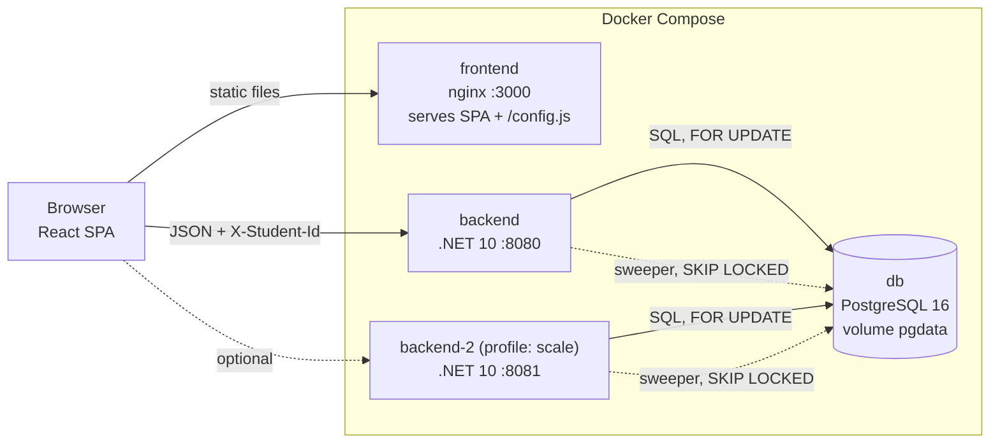
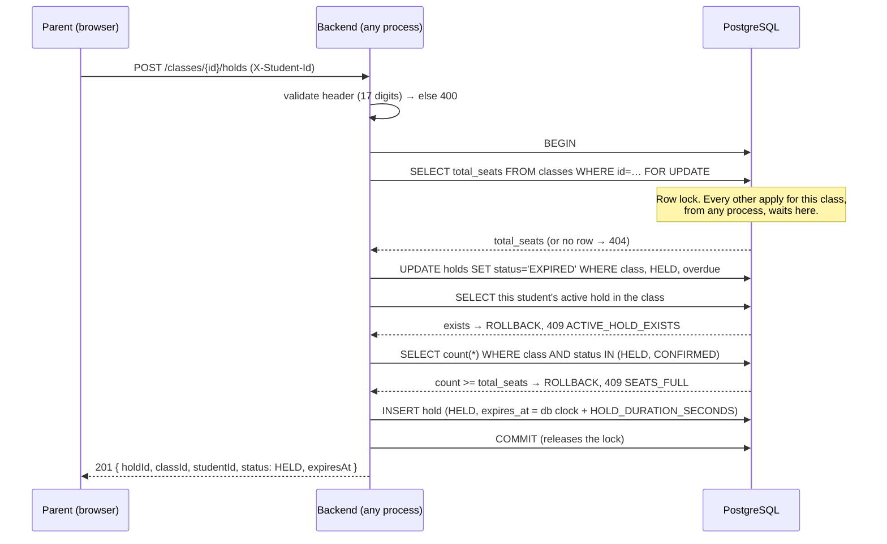
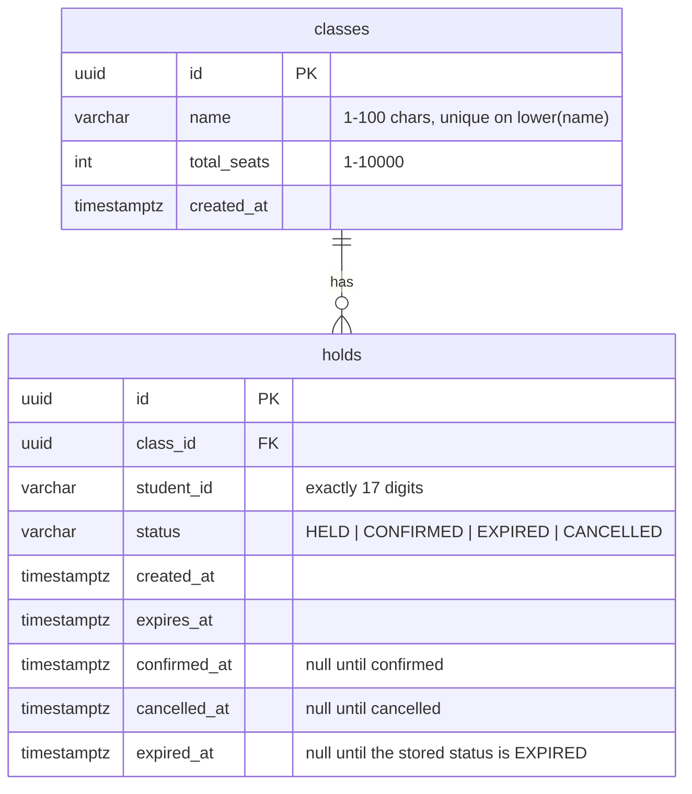
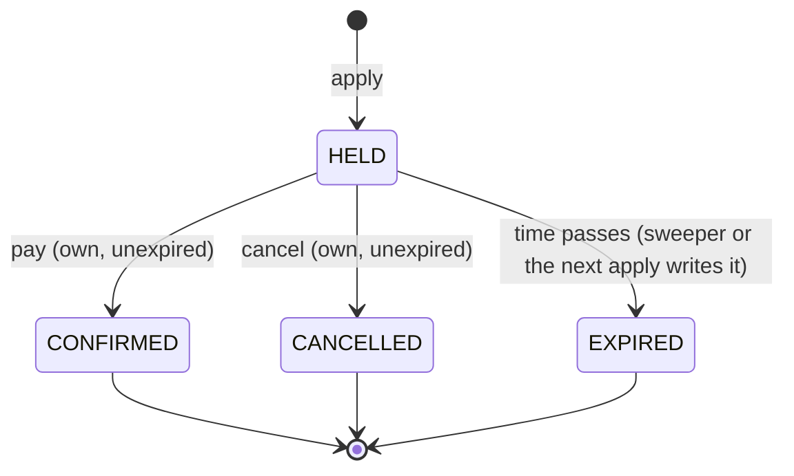

# Architecture: School Admission System

**Status:** Approved
**Author:** Kabir
**Date:** 2026-11-10
**PRD:** none. The assignment spec is the requirement source; it is restated as Req IDs in [§ Requirements](#requirements) below.

## Context

A private school admits students online, first come first served. Each class (one class and shift, for example "Class 6 - Morning Shift") has a fixed number of seats. When admission opens, thousands of parents apply at the same moment. Applying puts a seat on **hold** for a limited time. Paying the fee inside that time **confirms** the admission. An unpaid hold expires and its seat goes back to the pool.

The hard part is one invariant: for every class, `held + confirmed <= totalSeats`, always, under any number of concurrent requests and any number of backend processes. Everything else is a small CRUD app around that invariant. The design therefore puts the invariant in one place, the database, and keeps the rest simple.

## Requirements

IDs used through the rest of this doc, the stories, and the tests.

| ID | Requirement |
|---|---|
| `[BE-01]` | `held + confirmed` never exceeds `totalSeats` for a class, under any concurrency. |
| `[BE-02]` | Hold duration comes from `HOLD_DURATION_SECONDS` (default 600). An expired hold frees its seat on its own; no API call is needed. |
| `[BE-03]` | A student has at most one active hold or confirmed admission per class at a time. |
| `[BE-04]` | Only the student's own, unexpired `HELD` hold can be confirmed. |
| `[BE-05]` | Confirming the same hold many times raises `confirmedSeats` only once. |
| `[BE-06]` | No data is lost on restart, including `docker compose down` then `up`. |
| `[API-01]`…`[API-08]` | The eight endpoints match the contract exactly (see [Key interfaces](#key-interfaces)). Extra fields allowed; none removed or renamed. |
| `[UI-01]` | Every task can be done from the UI. Four screens: create class, class list, application, my applications. |
| `[UI-02]` | When a hold expires the UI shows `EXPIRED` with no page reload, and "Pay admission fee" is disabled. |
| `[UI-03]` | Class seat counts refresh every few seconds with no reload. |
| `[UI-04]` | After a page refresh or a browser restart, the student still sees their active applications. |
| `[UI-05]` | Every error is shown in words the user understands. No blank page, no console-only error. |
| `[UI-06]` | No login. A box at the top takes the 17-digit birth registration number and the UI uses it as the student's identity. |
| `[OPS-01]` | `docker compose up` starts PostgreSQL, backend and frontend together, with nothing installed but Docker. |
| `[OPS-02]` | Backend listens on `http://localhost:8080`; the DB connection comes from an environment variable. |
| `[OPS-03]` | The frontend's backend URL comes from an environment variable and can be changed at container runtime. |
| `[BONUS-01]` | Two backend processes on different ports, sharing one database, still never exceed `totalSeats`. |
| `[BONUS-02]` | Automated frontend tests. |
| `[DLV-01]` | At least three automated backend tests, one of them a concurrency test. |

## High-level diagram

The backend processes are stateless. They share nothing except the database, so all coordination between them happens there.

## Components

| Component | Responsibility | Implements | Notes |
|---|---|---|---|
| `SchoolAdmission.Domain` | `HoldStatus`, error codes, validation rules (student ID, class name, seat range). | `[BE-03]` `[BE-04]` | No dependencies. |
| `SchoolAdmission.Application` | `ClassService`, `HoldService`, the ports they call, DTOs, `Result<T>`. | `[API-01]`…`[API-08]` | Plain services. No MediatR: eight endpoints do not need a pipeline. |
| `SchoolAdmission.Infrastructure` | EF Core `DbContext`, the SQL for hold / confirm / cancel / sweep, `ExpirySweeper`, options and their startup validation. | `[BE-01]`…`[BE-06]` | The only project that knows SQL. |
| `SchoolAdmission.Api` | Minimal API endpoints, `X-Student-Id` handling, `Result` → HTTP mapping, ProblemDetails, CORS, `/health`. | `[API-01]`…`[API-08]` `[OPS-02]` | One place maps error codes to status codes. |
| `backend/db/init/*.sql` | The schema. Applied once by the Postgres container on first start. | `[BE-06]` | [ADR 0003](../adrs/0003-database-first-sql-schema-applied-by-postgres-init.md). |
| `ExpirySweeper` | `BackgroundService` that writes `EXPIRED` on overdue holds every ~5 s. | `[BE-02]` | Timeliness only. Correctness does not depend on it ([ADR 0002](../adrs/0002-lazy-expiry-is-the-guarantee-sweeper-for-timeliness.md)). |
| Frontend `shared/api` | One `apiClient`: adds the header, parses ProblemDetails, maps `code` → message. | `[UI-05]` `[OPS-03]` | Reads the API URL from `window.__APP_CONFIG__` at runtime. |
| Frontend `features/student` | The student-ID box, validation, `localStorage` persistence. | `[UI-04]` `[UI-06]` | |
| Frontend `features/classes` | Class list with live counts, "Apply", admin "create class" form. | `[UI-01]` `[UI-03]` | Polls every 3 s. |
| Frontend `features/holds` | Application screen with countdown, pay, cancel; "My applications". | `[UI-01]` `[UI-02]` `[UI-04]` | Countdown corrected for clock skew. |
| `docker-compose.yml` | `db`, `backend`, `frontend`; profiles `scale` and `test`. | `[OPS-01]` `[BONUS-01]` | |

## Data flow

### Apply for a seat (the critical path)

`POST /classes/{classId}/holds` runs one database transaction. This is the only place a seat can be taken.

1. The API validates `X-Student-Id` before touching the database.
2. The transaction locks the class row. Two applies for the same class cannot be inside steps 3 to 6 at the same time, whichever process they came through. Applies for different classes do not block each other.
3. Overdue holds in this class are written as `EXPIRED` first, so their seats are free for this request.
4. If the student already has an active hold or a confirmed seat in this class, the request is refused. A partial unique index backs this check up.
5. Active holds are counted. Because the lock is held, the count cannot change before the insert.
6. The hold is inserted with an expiry computed from the database clock.

### Confirm (pay the fee)

One statement: `UPDATE holds SET status='CONFIRMED' … WHERE id=… AND student_id=… AND status='HELD' AND expires_at > now()`. If it changed a row, the answer is 200. If it changed nothing, the service reads the row to say why: already confirmed by this student (200 again, idempotent), expired (409), cancelled (409), someone else's (403), or missing (404). Ten parallel confirms change the row once, so `confirmedSeats` rises once. No class lock is needed, because `HELD → CONFIRMED` does not change `held + confirmed`.

### Cancel

One statement, same shape: `HELD` and unexpired → `CANCELLED`, 204. Cancelling an already cancelled hold is 204 again. Cancelling a confirmed or expired hold is 409.

### Expiry

Nothing has to happen for a seat to come back. Every read counts a seat as held only when `status='HELD' AND expires_at > now()`, and presents an overdue `HELD` row as `EXPIRED`. The sweeper later writes `EXPIRED` so the stored status catches up. See [ADR 0002](../adrs/0002-lazy-expiry-is-the-guarantee-sweeper-for-timeliness.md).

### Frontend

1. On load, the app reads the student ID from `localStorage`. If present, it fetches `GET /me/holds` and shows the student's applications (`[UI-04]`).
2. The class list polls `GET /classes` every 3 s (`[UI-03]`).
3. "Apply" calls the hold endpoint and opens the application screen for the new hold.
4. The application screen counts down from the server's `remainingMs`, re-rendering every second. At zero it shows `EXPIRED`, disables "Pay admission fee", and refetches the hold (`[UI-02]`).

## Data model

Two tables. Seat counts are never stored; they are computed from `holds`.

Constraints and indexes:

- `ux_classes_name_ci`: unique on `lower(name)`. Duplicate class name → 409 `CLASS_NAME_TAKEN`.
- `ux_holds_active_per_student`: unique on `(class_id, student_id) WHERE status IN ('HELD','CONFIRMED')`. Enforces `[BE-03]` in the database.
- `ix_holds_class_status` on `(class_id, status)`: the seat count.
- `ix_holds_student_created` on `(student_id, created_at DESC)`: `GET /me/holds`.
- `ix_holds_due` on `(expires_at) WHERE status = 'HELD'`: the sweeper.
- `CHECK` constraints on the status values, the seat range, and the 17-digit student ID.

Hold state machine (the stored status):

`CONFIRMED`, `CANCELLED` and `EXPIRED` are terminal. Nothing ever moves a hold back to `HELD`, so the only way the active count of a class can rise is an insert, and inserts happen only under the class lock.

## Key interfaces

Base URL `http://localhost:8080`. JSON, camelCase. IDs are UUID strings. Timestamps are ISO-8601 UTC with whole seconds, ending in `Z`, the same shape as the contract's examples. The database keeps microseconds; on the wire `expiresAt` is rounded **up** to the next second and `serverTime` is rounded down, so once the reported `expiresAt` has passed the hold is certainly expired.

| # | Method & path | Header | Success | Body (contract fields; extras in *italics*) |
|---|---|---|---|---|
| 1 | `POST /classes` | — | 201 + `Location` | `id`, `name`, `totalSeats` |
| 2 | `GET /classes` | — | 200 | array of `id`, `name`, `totalSeats`, `heldSeats`, `confirmedSeats`, `availableSeats`; ordered by name |
| 3 | `GET /classes/{classId}` | — | 200 | same object as one element of #2 |
| 4 | `POST /classes/{classId}/holds` | `X-Student-Id` | 201 + `Location` | `holdId`, `classId`, `studentId`, `status`, `expiresAt`, *`className`*, *`createdAt`*, *`serverTime`*, *`remainingMs`* |
| 5 | `GET /holds/{holdId}` | none required | 200 | `holdId`, `classId`, `status`, `expiresAt`, *`className`*, *`createdAt`*, *`serverTime`*, *`remainingMs`*. Never `studentId`. |
| 6 | `POST /holds/{holdId}/confirm` | `X-Student-Id` | 200 | `holdId`, `status`, *`classId`*, *`serverTime`* |
| 7 | `DELETE /holds/{holdId}` | `X-Student-Id` | 204, empty body | — |
| 8 | `GET /me/holds` | `X-Student-Id` | 200 | array of `holdId`, `classId`, `className`, `status`, `expiresAt`, *`createdAt`*, *`serverTime`*, *`remainingMs`*; all statuses, newest first |

Also `GET /health` → 200 when the database answers, and `GET /settings` → `{ holdDurationSeconds }`, so the UI can state the real hold time instead of a fixed "10 minutes".

Errors are RFC 7807 ProblemDetails with an extra `code`:

| Status | `code` | When |
|---|---|---|
| 400 | `INVALID_STUDENT_ID` | `X-Student-Id` missing or not exactly 17 ASCII digits (endpoints 4, 6, 7, 8) |
| 400 | `VALIDATION_FAILED` | Bad class name or seat count; malformed or missing JSON |
| 403 | `NOT_YOUR_HOLD` | Confirm or cancel on another student's hold |
| 404 | `CLASS_NOT_FOUND`, `HOLD_NOT_FOUND`, `NOT_FOUND` | Unknown id; unknown route |
| 405 | `METHOD_NOT_ALLOWED` | Known route, wrong method |
| 409 | `SEATS_FULL` | No seat available |
| 409 | `ACTIVE_HOLD_EXISTS` | Student already holds or has confirmed a seat in this class |
| 409 | `HOLD_EXPIRED` | Confirm or cancel after expiry |
| 409 | `HOLD_CANCELLED` | Confirm on a cancelled hold |
| 409 | `HOLD_ALREADY_CONFIRMED` | Cancel on a confirmed hold |
| 409 | `CLASS_NAME_TAKEN` | Duplicate class name (case-insensitive) |
| 503 | `SERVICE_UNAVAILABLE` | The database cannot be reached, or no connection was free in time. Sent with `Retry-After`. |
| 500 | `INTERNAL_ERROR` | Anything unexpected. No stack trace in the body. |

Check order on endpoints with several possible failures: header (400) → existence (404) → ownership (403) → state (409).

## Technology choices

| Choice | Selected | Alternatives considered | Rationale |
|---|---|---|---|
| Runtime | .NET 10 | .NET 8 (the minimum allowed) | Current LTS. |
| API style | Minimal APIs | MVC controllers | Eight endpoints; less ceremony. |
| Data access | EF Core (Npgsql) for class writes and simple reads; raw SQL in explicit transactions for hold, confirm, cancel, sweep | Dapper only; EF LINQ everywhere | The critical statements should be readable as SQL, exactly as the ADR states them. EF handles the boring parts. |
| Concurrency guard | Per-class row lock `FOR UPDATE` + partial unique index | See [ADR 0001](../adrs/0001-seat-invariant-enforced-by-per-class-row-lock.md) | Works across processes with no extra code. |
| Expiry | Lazy at read time + sweeper | See [ADR 0002](../adrs/0002-lazy-expiry-is-the-guarantee-sweeper-for-timeliness.md) | Correct even with the sweeper stopped. |
| Schema | SQL files run by Postgres init | See [ADR 0003](../adrs/0003-database-first-sql-schema-applied-by-postgres-init.md) | No migration race between two backends. |
| Frontend data | TanStack Query | Hand-rolled `useEffect` polling; SWR | Polling, refetch on focus, and in-flight state come built in. |
| Frontend styling | Plain CSS | A component library | Looks are not graded; fewer dependencies. |
| Frontend tests | Vitest + React Testing Library + MSW | Jest; Playwright | Runs in the Vite toolchain; MSW tests the real `apiClient`. |
| Static serving | nginx | `vite preview`; Node server | Small image; the entrypoint hook writes `/config.js` at start. |

## Cross-cutting concerns

- **Error handling strategy:** services return `Result<T>` carrying an error code. One mapper in the API turns a code into a status and a ProblemDetails body. An exception handler turns anything unexpected into a 500 ProblemDetails with no stack trace. Unknown routes and malformed JSON also answer as ProblemDetails.
- **Logging / observability conventions:** default ASP.NET Core console logging. The sweeper logs how many holds it expired when the number is above zero. Unhandled exceptions are logged with the stack trace server-side only.
- **Auth / authorization:** none, by requirement. `X-Student-Id` is an identity claim, not a credential. Ownership checks (confirm, cancel) compare against it. See [Security](#security).
- **Caching strategy:** none. Seat counts must be live. nginx sends `no-store` for `/config.js` and `index.html`.
- **Configuration / secrets:** environment variables only. `ConnectionStrings__Default`, `HOLD_DURATION_SECONDS`, `CORS_ORIGINS`, `SWEEPER_ENABLED`, `SWEEP_INTERVAL_SECONDS`, and `API_URL` for the frontend. Invalid values stop the backend at startup with a clear message. The database password in `docker-compose.yml` is a local demo value.
- **Time:** the database clock is the only clock for expiry. Hold responses carry `remainingMs`, the exact time left on that clock. The UI adds it to its own clock when the answer arrives and counts down from there, so a wrong device clock and the whole-second rounding of the timestamps do not affect the countdown. `serverTime` is sent as well, for any other client.
- **Internationalization / locale:** user-facing error messages are in English with a Bangla line. Timestamps are UTC on the wire and shown in the browser's local time.
- **Background jobs / async work:** one `BackgroundService`, the expiry sweeper.

## Deployment topology

Docker Compose on one host.

- `db`: `postgres:16`, named volume `pgdata`, schema from `backend/db/init` (mounted read-only into `/docker-entrypoint-initdb.d`), health check over TCP so "healthy" means the real server is up, not the temporary init server. No host port by default.
- `backend`: built from `backend/Dockerfile`, port `8080:8080`, starts after `db` is healthy, `restart: unless-stopped`.
- `frontend`: built from `frontend/Dockerfile` (node build → nginx), port `3000:80`. The container entrypoint writes `/config.js` from `API_URL`.
- `backend-2` (profile `scale`): the same image on `8081:8080`, same database.
- `tests`, `frontend-tests` (profile `test`): run the test suites inside containers.

Scaling axis: add backend processes. They are stateless and coordinate only through row locks. The per-class lock serializes applies for one class, which is what first-come-first-served requires anyway. Different classes run in parallel. Each backend caps its connection pool so that several processes fit under the database's connection limit.

Failure domains: if a backend dies mid-transaction, Postgres rolls the transaction back and releases the lock. If the database is down, `/health` fails and the API answers 500 ProblemDetails; the UI shows "server unreachable".

## Observability

Console logs from all three containers (`docker compose logs`). `/health` on the backend. No metrics or tracing: out of proportion for this scope.

## Security

- **Trust boundary:** the browser is untrusted. All validation is repeated on the server; the database constraints are the last line.
- **Auth model:** none (the spec says no login, and the graders' tests call the API without credentials). Anyone who knows a student's 17-digit number can act as that student, and anyone can create a class. This is a known and documented trade-off; the production design is in `ASSUMPTIONS.md`.
- **What is done anyway:** IDs are random UUIDs, so holds and classes cannot be enumerated. `GET /holds/{holdId}` has no ownership check, so it never returns `studentId`. No endpoint lists applicants. All SQL is parameterized. CORS allows only the configured origins. Error bodies never include stack traces or SQL.
- **Sensitive data:** the birth registration number is personal data. It is stored because it is the identity, is returned only to a caller who already sent it, and is not logged.

## Risks

| Risk | Likelihood | Impact | Mitigation |
|---|---|---|---|
| Overbooking under load | Low | Critical | Row lock + count inside one transaction; concurrency tests with 200 parallel requests, and with two hosts. |
| Lock queue on one hot class slows applies | Medium | Low | The transaction is five short statements. Applies for other classes are not blocked. Acceptable: FCFS needs an order anyway. |
| Connection exhaustion when hundreds of requests wait on one lock | Medium | Medium | Pool capped per process (`Maximum Pool Size`), Postgres `max_connections` raised in compose; waiting requests queue in the pool, they do not fail. |
| Sweeper stopped or slow | Low | None for correctness | Lazy expiry on every read and inside the hold transaction. |
| Client clock wrong, countdown misleading | Medium | Low | `remainingMs` in hold responses, counted down with elapsed time only; the server decides in the end and the UI refetches at zero. |
| Schema init does not rerun on an existing volume | Low | Medium | Documented: `docker compose down -v` resets. No schema changes are planned after first run. |
| API URL baked into the JS bundle | Low | High (fails a stated requirement) | `/config.js` is written at container start; verified by starting the image with a different `API_URL`. |
| Contract drift (renamed field, wrong status) | Low | Critical (automated grading) | Contract tests assert exact field names, types and status codes for all eight endpoints. |

## Alternatives considered

- **In-process lock (`lock`, `SemaphoreSlim`) around the seat check.** Fails with two processes and is lost on restart. Rejected in [ADR 0001](../adrs/0001-seat-invariant-enforced-by-per-class-row-lock.md).
- **Stored counters (`held_seats`, `confirmed_seats` columns).** Fast reads, but a counter can drift from the rows it summarizes, and expiry would need a write to keep it right. Rejected in ADR 0001 and [ADR 0002](../adrs/0002-lazy-expiry-is-the-guarantee-sweeper-for-timeliness.md).
- **Redis for holds with TTL.** A second store to keep consistent with Postgres, and TTL expiry there is not transactional with the confirm. Not needed at this size.
- **A queue in front of the hold endpoint.** Gives ordering, but the row lock already gives it, with fewer parts.
- **Expiry only by a background job.** Then correctness depends on the job running on time. Rejected in ADR 0002.
- **EF Core migrations at startup.** Two backends would race to migrate. Rejected in [ADR 0003](../adrs/0003-database-first-sql-schema-applied-by-postgres-init.md).
- **WebSockets / SSE for live counts.** The requirement is "every few seconds"; polling meets it with no extra infrastructure.

## Requirement traceability

| Req ID | Mechanism | Proved by | Story |
|---|---|---|---|
| `[BE-01]` | Class row `FOR UPDATE`, then count and insert in one transaction (ADR 0001) | Test: 200 parallel applies on 10 seats → exactly 10 succeed | 003 |
| `[BE-02]` | `expires_at` from the DB clock + `HOLD_DURATION_SECONDS`; lazy expiry on reads; sweeper (ADR 0002); startup validation | Test: 1 s hold expires with the sweeper off; then `RunOnceAsync` writes `EXPIRED` | 003, 004, 006 |
| `[BE-03]` | Check under the class lock + partial unique index | Test: 20 parallel applies by one student → exactly 1 succeeds; re-apply after cancel / expiry → 201 | 003, 005 |
| `[BE-04]` | Conditional `UPDATE … WHERE student_id AND status='HELD' AND expires_at > now()` | Tests: other student → 403; expired → 409; cancelled → 409 | 005 |
| `[BE-05]` | The same conditional `UPDATE` changes the row once; repeats return 200 without writing | Test: 10 parallel confirms → all 200, `confirmedSeats` = 1 | 005 |
| `[BE-06]` | Postgres named volume `pgdata`; no in-memory state in the backend | Manual check in the README: `down` then `up` keeps classes and holds | 001 |
| `[API-01]`…`[API-08]` | Minimal API endpoints + DTOs | Contract tests: field names, types, status codes, `Z` timestamps, no `studentId` on #5, empty 204 on #7 | 002–005, 007 |
| `[UI-01]` | Four screens, router, admin form | Manual walkthrough at Gate C | 009 |
| `[UI-02]` | Countdown hook; derived status `EXPIRED` at zero; button disabled; refetch | Frontend test with fake timers | 009, 010 |
| `[UI-03]` | TanStack Query `refetchInterval: 3000` on the class list | Manual: counts change in a second browser | 009 |
| `[UI-04]` | Student ID in `localStorage`; `/me/holds` fetched on load | Frontend test: persist and restore after remount | 008, 009 |
| `[UI-05]` | `apiClient` error mapper; root error boundary; loading and empty states | Frontend test: every `code` and a network failure → a message | 008, 010 |
| `[UI-06]` | Student-ID box in the header, 17-digit validation | Frontend test: rejects invalid input | 008 |
| `[OPS-01]` | `docker-compose.yml` with health-gated start order | Fresh clone → `docker compose up --build` | 001, 010 |
| `[OPS-02]` | Port mapping `8080:8080`; `ConnectionStrings__Default` | Same | 001 |
| `[OPS-03]` | nginx entrypoint writes `/config.js` from `API_URL` | Run the built image with another `API_URL`; the app calls it | 008, 010 |
| `[BONUS-01]` | The lock lives in Postgres, so it holds for any number of processes | Test: two hosts, one database, 100 parallel applies on 10 seats; `--profile scale` demo | 007, 010 |
| `[BONUS-02]` | Vitest + RTL + MSW | `docker compose --profile test run --rm frontend-tests` | 010 |
| `[DLV-01]` | xUnit suite against real Postgres | `docker compose --profile test run --rm tests` | 003–007 |

## Open questions

None blocking. Decisions made where the spec is silent are listed, with reasons, in `ASSUMPTIONS.md`.
